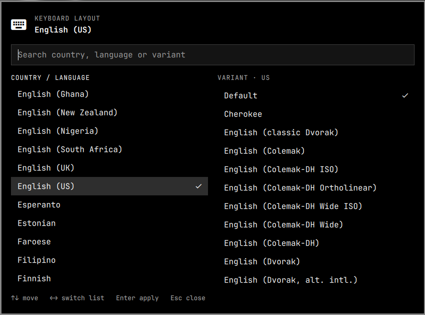

# Keymap Picker

Pick your keyboard layout from a list of countries and variants, the way GNOME's
input sources dialog does it, right from the Omarchy bar. The choice applies
immediately and is remembered across restarts.



## Features

- A bar badge with the active layout (`US`, `BR`, ...); click it to open the picker
- Country / language list on the left, the variants of the highlighted one on the right
- Search across country, language and variant names, so "dvorak" finds every country that has one
- The same list GNOME offers: it is read from xkeyboard-config (~100 layouts, ~500 variants)
- Applies instantly, no logout; the selection is saved and restored on the next login
- Full keyboard navigation: `↑` `↓` to move, `←` `→` to switch list, `Enter` to apply, `Esc` to close
- Theme-aware, built on the Omarchy shell UI components

It manages **one** layout at a time. If you need several layouts and a shortcut to
cycle between them, look at the other keyboard plugins in the marketplace.

## Install

```bash
omarchy plugin add https://github.com/andreas-yuji-fujiki-dev/omarchy-keymap-picker.git --enable
```

Plugins run as unsandboxed code inside `omarchy-shell`; the install command asks
before cloning and the code is small enough to read first (`Model.js`,
`BarWidget.qml`, `Panel.qml` and the `keymap-apply` shell script).

If the badge does not appear in the bar, move it there:

```bash
omarchy bar move andreas.keymap --section right
```

## Usage

Click the badge, pick a country, then pick a variant. A country with no variants
is applied as soon as you click it. Browsing the list never changes your layout;
only choosing a variant does.

The shell IPC target `andreas.keymap` exposes the same actions, so you can bind
keys or script it:

```bash
omarchy-shell andreas.keymap toggle            # open or close the picker
omarchy-shell andreas.keymap set br nodeadkeys # apply a layout and variant directly
omarchy-shell andreas.keymap set us ""         # layout with no variant
```

## What it changes on your system

Only when you pick a layout, the plugin does two things:

1. Applies it live with `hyprctl eval` (`kb_layout` and `kb_variant`).
2. Writes it to **`~/.config/hypr/input.lua`** so Hyprland keeps it after a reload
   or reboot. It adds one marked block at the end of the file and only ever
   rewrites that block:

   ```lua
   -- >>> andreas.keymap (managed by the Keymap plugin, edits here are overwritten) >>>
   hl.config({ input = { kb_layout = "br", kb_variant = "nodeadkeys" } })
   -- <<< andreas.keymap <<<
   ```

   The first time, a backup is saved next to it as `input.lua.bak.keymap`.
   Because the block comes last, it wins over any `kb_layout` you set earlier in
   that file. Other keyboard settings such as `kb_options` are left alone.

Nothing is written until you choose a layout.

## Remove

```bash
~/.config/omarchy/plugins/andreas.keymap/keymap-apply --forget   # drop the saved block from input.lua
omarchy plugin remove andreas.keymap
```

Run the first command before removing the plugin. Without it, your last choice
stays in `input.lua`, which is harmless but still applies. You can also delete
the marked block by hand.

## Requirements

- Omarchy with the shell plugin system (`omarchy plugin`) and Hyprland using the
  Lua configuration (the live apply uses `hyprctl eval`)
- `xkeyboard-config`, which provides `/usr/share/X11/xkb/rules/evdev.xml`
  (installed with any Hyprland setup)
- `bash`, `awk`, `sed` and `hyprctl`, all present on a standard Omarchy install

There are no other dependencies and nothing is downloaded.

## Development

The data handling is plain JavaScript with no Qt, so it tests under node:

```bash
node test/model.test.js
```

## License

[MIT](LICENSE)
